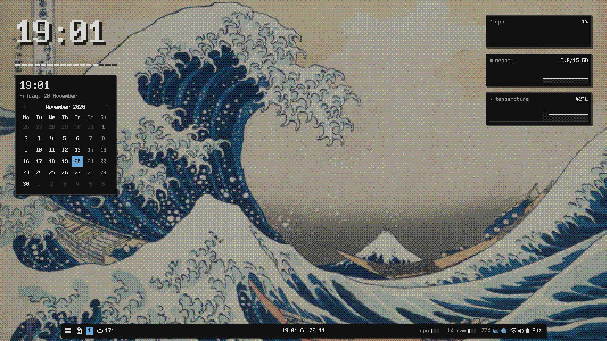

<div align="center">


# Smalta

A pixel desktop shell for niri and Hyprland, drawn in whole pixels.

[](LICENSE)


[Install](#installation) · [Commands](#commands) · [Configuration](#configuration) · [Русский](README.ru.md)

</div>



<sub>Wallpaper: Hokusai, <i>The Great Wave off Kanagawa</i> (public domain), as the shell draws it.</sub>

**Smalta** (from *smalt*, the blue glass of mosaics) is a desktop shell for the
[niri](https://github.com/YaLTeR/niri) and [Hyprland](https://hypr.land) Wayland compositors: the bar,
launcher, control center, notifications, tray, OSD, desktop widgets, wallpaper, screenshots and
settings, in bitmap fonts, one-pixel frames, dithering and a grey palette with one accent. It draws
every pixel itself, in Rust with no toolkit, and the binary links nothing but glibc: no libwayland,
no libxkbcommon, no fontconfig.

It is the successor of [Tessera](https://github.com/cublae/Tessera): the same modules and the same
config format, with Quickshell and Material swapped for pixels.

## Features

- **No toolkit.** Wayland through [smithay-client-toolkit](https://github.com/Smithay/client-toolkit),
  pixels into shared memory, text from BDF fonts without antialiasing, the keymap through
  [kbvm](https://github.com/mahkoh/kbvm), D-Bus through [zbus](https://github.com/z-galaxy/zbus).
  Fonts and colour emoji are baked in at build time; surfaces are redrawn only when something
  on them changes.
- **Bar** on every monitor, at the top or the bottom, full width or floating. Modules: `launcher`,
  `clipboard`, `workspaces`, `focused-window`, `clock`, `media`, `weather`, `tray`, `privacy`,
  `screencast`, `recording`, `resources`, `keyboard-layout`, `notifications`, `system-indicators`,
  `control-center`.
- **Control center.** Battery with the time left to empty or to full, and a warning at 15 %;
  Wi-Fi (networks, passwords, hidden networks, forget); Bluetooth with pairing, the charge of
  headphones and mice on the bar and a warning when it runs low; volume, microphone, brightness,
  power profiles, do not disturb; screenshot, colour picker, screen recording; a mixer with
  device choice and per-app volume; the session (lock, log out, suspend, restart, power off).
- **Session menu** over the whole screen: `smalta toggle session` puts five big tiles under a big
  clock. Arrows, Tab or the digits `1`–`5` choose, Enter does it, Esc or a click past the tiles
  goes back. It opens on Lock, so a stray Enter costs nothing.
- **Launcher.** Apps with icons from the GTK theme, fuzzy search ranked by how often you start
  them; a calculator (`2+2*3`), emoji after `:`, a shell command after `>`, files in your home
  after `/`, the shell's own settings after `?`, open windows after `#`, clipboard history after
  `@`; units and currencies (`10 km in mi`, `100 usd in eur`, rates from open.er-api.com twice a
  day, and only once you ask).
- **Window switcher.** A card for every window, the last used first; windows on visible workspaces
  are shown as previews brought down to big dithered pixels. Bind `smalta switch` to Alt+Tab: the
  first press opens on the previous window, the next ones move on, letting go of Alt (or Super,
  Ctrl) switches.
- **Clipboard** in a side panel: cards with image previews and when they were copied, search,
  pinning; Enter or a click copies, Delete deletes.
- **Notifications.** Its own `org.freedesktop.Notifications` server, toasts with actions, a
  notification center, do not disturb.
- **Tray** (StatusNotifierItem): icons brought down to pixels, dbusmenu menus under them.
- **Visualizer.** While something plays, pixel bars from cava jump beside the song in the `media`
  module; when nothing plays, cava is not running.
- **Calendar, weather** (Open-Meteo, no key) and an **OSD** for volume, brightness, keyboard layout,
  Caps Lock and Num Lock.
- **Desktop widgets.** A big pixel clock with the date and the day's progress, a calendar, graphs
  for CPU, memory and temperature, what is playing.
- **Screenshots with an editor.** Every monitor freezes, the mouse selects an area (a click takes
  the whole screen), then frames, arrows, a pencil and pixelation in four colours. Enter or `c`
  copies the PNG, `s` also saves it to `~/Pictures/Screenshots`.
- **Colour picker.** Every monitor freezes through wlr-screencopy, a loupe shows the pixels under
  the cursor, a click copies the colour.
- **Pixel wallpaper.** Any picture in big cells, dithered, tinted into the theme's tones and
  darkened, or drawn as it is; the accent can come from it.
- **Settings** in a window you can move and resize; every change applies at once, without a restart.
- **Transitions.** A new accent, wallpaper or tint does not snap in: it dissolves over half a second
  in blocks along an 8×8 Bayer matrix, the bar, wallpaper and widgets together.
- **Privacy.** A light for the microphone and the camera; on Hyprland, the windows of chosen apps
  are hidden from screen sharing.
- **Colour emoji** (Noto) in all of the shell's text, flags included.
- **Two languages**, English and Russian, by the locale or a setting.

## Installation

Smalta is packaged as a Nix flake.

```sh
nix run github:cublae/Smalta
```

### Home Manager

```nix
{
  inputs.smalta.url = "github:cublae/Smalta";

  imports = [ inputs.smalta.homeManagerModules.default ];

  programs.smalta = {
    enable = true;
    settings = {
      bar.position = "top";
      theme.accent = "#e0607e";
      weather.location = "Lisbon";
      desktop.enabled = true;
    };
  };
}
```

The module installs the package, writes `~/.config/smalta/config.json` from `settings` and adds a
systemd user service on `graphical-session.target`. To start it from the compositor instead, turn
the service off (`systemd.enable = false`) and add `spawn-at-startup "smalta"` to niri or
`hl.exec_cmd("smalta")` to `hyprland.start`.

Without `settings` the module leaves the config alone: edit it by hand or in the settings window.
With `settings`, the file belongs to Home Manager, and the settings window only shows it.

### Building by hand

```sh
nix develop
cargo build --release
```

The dev shell sets the paths of the fonts that get baked in: Spleen 8×16 (`SMALTA_FONT`), GNU
Unifont for everything Spleen lacks (`SMALTA_UNIFONT`, `SMALTA_UNIFONT_UPPER`) and Noto's colour
emoji (`SMALTA_EMOJI`); see [`nix/package.nix`](nix/package.nix) to build without Nix.

Programs it runs, each feature staying dark without its own: `pactl` (audio), `nmcli` (network),
`cliphist` and `wl-clipboard` (clipboard), `grim` and `slurp` (screenshots on Hyprland), `curl`
(weather and exchange rates), `cava` (visualizer), `gpu-screen-recorder` (recording),
`systemctl` and `loginctl` (session).

## Commands

Running `smalta` with no arguments starts the shell; with arguments, it talks to the one already
running over a unix socket.

```sh
smalta toggle launcher            # also: control-center, calendar, clipboard,
smalta toggle notification-center # weather, windows
smalta toggle settings            # the settings window
smalta toggle session             # the full-screen session menu
smalta screenshot                 # freeze the screens, select, mark up, copy or save
smalta pick-color                 # freeze the screens, click a pixel to copy its colour
smalta switch                     # the window switcher; `switch back` goes the other way
smalta reload                     # read the config again and apply it
smalta toggle-hidden              # the focused window out of screen sharing, or back in
smalta close                      # close whatever is open
smalta quit
```

Key bindings for niri:

```kdl
binds {
    Mod+Space { spawn "smalta" "toggle" "launcher"; }
    Mod+Escape { spawn "smalta" "toggle" "session"; }
    Print { spawn "smalta" "screenshot"; }
    Mod+Shift+C { spawn "smalta" "pick-color"; }
    Alt+Tab { spawn "smalta" "switch"; }
    Alt+Shift+Tab { spawn "smalta" "switch" "back"; }
}
```

And for Hyprland:

```lua
hl.bind("SUPER + SPACE", hl.dsp.exec_cmd("smalta toggle launcher"))
hl.bind("SUPER + ESCAPE", hl.dsp.exec_cmd("smalta toggle session"))
hl.bind("PRINT", hl.dsp.exec_cmd("smalta screenshot"))
hl.bind("SUPER + SHIFT + C", hl.dsp.exec_cmd("smalta pick-color"))
hl.bind("ALT + TAB", hl.dsp.exec_cmd("smalta switch"))
hl.bind("ALT + SHIFT + TAB", hl.dsp.exec_cmd("smalta switch back"))
```

In the screenshot editor: `1`–`4` pick the tool, Tab the colour, Backspace takes back the last mark,
Esc leaves.

## Configuration

`~/.config/smalta/config.json`. Without it, Smalta reads Tessera's config; keys it does not know
are skipped.

Nearly everything is in the settings window (the gear in the control center, or
`smalta toggle settings`): the theme, the bar and its shape, modules dragged between sections, the
control center's tiles, widgets, notifications and the OSD, weather. Each change is written to the
file and applied at once; the window touches only its own keys and keeps the rest. Only weather,
the notification server and the tray need a restart, since the shell sets them up at start, and it
restarts by itself. A config edited by hand applies with `smalta reload`.

| Key | Default | What it does |
|---|---|---|
| `bar.position` | `"bottom"` | `top` or `bottom` |
| `bar.size` | `30` | Bar thickness, in shell pixels |
| `bar.modules.{start,center,end}` | launcher and workspaces / clock / resources and layout | Modules by section |
| `bar.floating` | `false` | A floating bar: a gap from the edge, a frame, a shadow |
| `bar.width` | `100` | Width of the floating bar, % of the screen |
| `bar.margin` | `6` | Gap between the floating bar and the screen edge |
| `bar.{edgeStart,edgeEnd}` | `6` | Room before the first module and after the last |
| `bar.gap` | `4` | Room between modules |
| `workspaces.perMonitor` | `true` | Only the monitor's own workspaces |
| `workspaces.showEmpty` | `false` | Show empty workspaces |
| `clock.format` | `"%H:%M"` | Clock format (strftime) |
| `theme.accent` | — | The active colour, `#rrggbb`. Without it the shell is all grey |
| `theme.font` | Spleen 8×16 | Path to any BDF font. Missing glyphs come from GNU Unifont |
| `theme.pixel` | `1` | Screen pixels per shell pixel: `2` doubles everything and stays sharp. Fractions such as `1.5` work too, still without blur, with pixels alternating one screen pixel wider and narrower |
| `theme.tintIcons` | `false` | App and tray icons in the theme's tones, from the background to the accent |
| `wallpaper.enabled` | `false` | Draw its own wallpaper (over another program's) |
| `wallpaper.path` | Tessera's `theme.wallpaper` | The picture: PNG, JPEG or BMP |
| `wallpaper.pixelate` | `true` | Big pixels and few shades; `false` draws the picture as it is, at the screen's resolution (tint and dimming stay) |
| `wallpaper.cell` | `3` | Screen pixels per wallpaper cell |
| `wallpaper.levels` | `6` | Shades per channel (or of grey when tinted) |
| `wallpaper.dither` | `true` | Dither between shades instead of bands |
| `wallpaper.tint` | `"none"` | `none`, `mono` (the theme's greys) or `duotone` (through the accent) |
| `wallpaper.dim` | `0` | Darkening, 0 to 0.9 |
| `wallpaper.accent` | `false` | The accent from the wallpaper, when the theme sets none |
| `media.visualizer` | `true` | Bars to the sound beside the song in `media` (through cava) |
| `media.bars` | `10` | How many bars |
| `interface.language` | `"auto"` | `ru`, `en`, or by the locale |
| `weather.location` | — | A city; or `weather.latitude` and `weather.longitude` |
| `weather.units` | `"metric"` | `metric` or `imperial` |
| `weather.interval` | `30` | Minutes between updates |
| `desktop.enabled` | `false` | Desktop widgets |
| `desktop.clockFormat` | `"%H:%M"` | Format of the big clock |
| `desktop.show{Date,Calendar,Graphs,Media}` | `true` | Which widgets to show |
| `notifications.server` | `true` | Its own notification server; turn it off for mako or dunst |
| `notifications.timeout` | `6` | Seconds a toast stays |
| `notifications.pauseOnHover` | `true` | A toast under the pointer stays |
| `notifications.criticalSticky` | `true` | Urgent ones stay until closed |
| `notifications.appTimeout` | `true` | Use the time an app asks for (up to a minute) |
| `notifications.maxToasts` | `4` | Toasts on screen at once |
| `notifications.history` | `100` | How many to keep in the history |
| `notifications.position` | `"auto"` | `top-right`, `top-left`, `bottom-right`, `bottom-left` or by the bar |
| `notifications.quietWhenSharing` | `true` | Straight to the history while the screen is shared |
| `osd.{volume,microphone,brightness,layout,locks}` | `true` | What the OSD shows (`locks`: Caps Lock and Num Lock) |
| `osd.timeout` | `1500` | How long the OSD stays, ms |
| `osd.position` | `"auto"` | `top`, `center`, `bottom` or by the bar |
| `tray.enabled` | `true` | Its own tray; turn it off when another program hosts one |
| `controlCenter.tiles` | all | What the control center shows: `wifi`, `bluetooth`, `dnd`, `profiles`, `volume`, `microphone`, `brightness`, `actions`, `media` |
| `screenshare.hide` | `[]` | App classes whose windows are a black box in screen sharing and screenshots (Hyprland). On niri, its `block-out-from "screencast"` rule does the same |

## Resource usage

Measured in a nested niri window of about 1300×1000 with the pixel wallpaper, desktop widgets and a floating bar
(PSS, shared library pages split fairly; RSS in brackets):

| What | Memory |
|---|---|
| idle: bar, wallpaper, widgets, tray, notification server | 18 MB (27 MB) |
| with the settings window open, and once it closes again | 23 MB (37 MB) → 18 MB |
| binary on disk, fonts and emoji included | 11 MB |

## Not there yet, compared to Tessera

- A vertical bar (`left`, `right`) and per-monitor bar layouts (`bar.outputs`).
- The proxy page and screen recording settings: recording uses fixed settings through the portal,
  into `~/Videos`.
- Rearranging the desktop widgets.

## Development

```sh
nix develop
cargo run
```

`RUST_LOG=debug` turns on the detailed log. Before a commit: `cargo fmt`, `cargo clippy`,
`cargo test`.

| Path | Contents |
|---|---|
| `src/main.rs` | the event loop, surfaces, input, IPC commands |
| `src/bar.rs`, `src/desktop.rs`, `src/wallpaper.rs` | the bar, the desktop widgets, the pixel wallpaper |
| `src/popups/` | launcher, control center, calendar, clipboard, notifications, settings, switcher, session menu, weather, tray menu |
| `src/services/` | audio, network, Bluetooth, power, media, tray, weather, camera, keyboard lights, exchange rates: one thread each |
| `src/compositor/` | niri and Hyprland IPC |
| `src/canvas.rs`, `src/font.rs`, `src/ui.rs` | drawing into shared memory, BDF text, widgets |
| `nix/`, `modules/`, `flake.nix` | the package and the Home Manager module |

## Made with Claude

Smalta is written with the help of [Claude](https://claude.ai) by Anthropic, through Claude Code.
Every change is still built, checked and used on a real machine before it lands.

## License

Code: MIT, see [LICENSE](LICENSE). The fonts baked into the binary keep their own licenses:
Spleen (BSD 2-Clause), GNU Unifont (SIL OFL 1.1 / GPL-2.0+ with the font embedding exception)
and Noto Color Emoji (SIL OFL 1.1).
