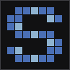
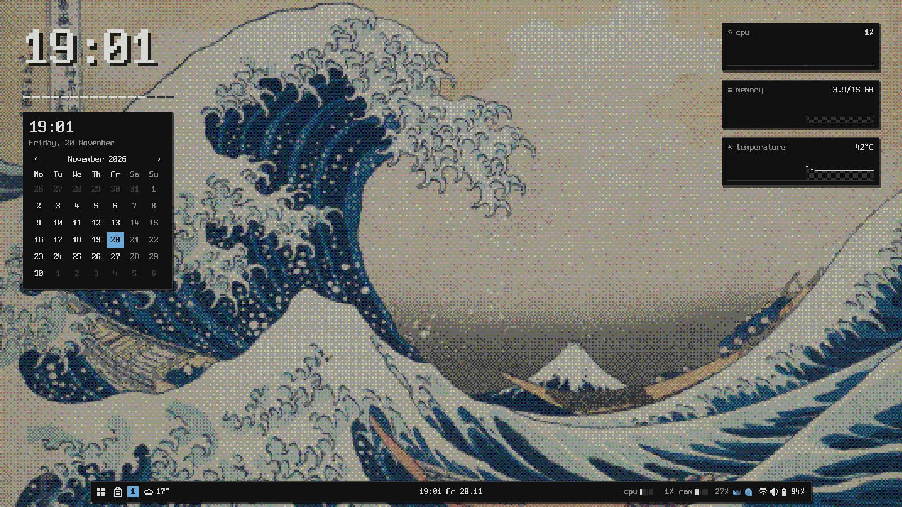

<div align="center">



# Smalta

Пиксельный desktop shell для niri и Hyprland, нарисованный целыми пикселями.

[](LICENSE)


[Установка](#установка) · [Команды](#команды) · [Конфиг](#конфиг) · [English](README.md)

</div>



<sub>На обоях — «Большая волна в Канагаве» Хокусая (общественное достояние), как её рисует шелл.</sub>

**Smalta** (от *смальты*, синего стекла мозаик) — desktop shell для Wayland-композиторов
[niri](https://github.com/YaLTeR/niri) и [Hyprland](https://hypr.land): панель, лаунчер, центр
управления, уведомления, трей, OSD, виджеты рабочего стола, обои, скриншоты и настройки. Растровые
шрифты, рамки в один пиксель, дизеринг и серая палитра с одним акцентом. Каждый пиксель Smalta рисует
сама, на Rust и без тулкита, а бинарник не зависит ни от чего, кроме glibc: ни libwayland, ни
libxkbcommon, ни fontconfig.

Наследник [Tessera](https://github.com/cublae/Tessera): тот же набор модулей и тот же формат конфига,
но вместо Quickshell и Material — пиксели.

## Что есть

- **Без тулкита.** Wayland через [smithay-client-toolkit](https://github.com/Smithay/client-toolkit),
  пиксели в разделяемую память, текст из BDF-шрифтов без сглаживания, раскладка клавиатуры через
  [kbvm](https://github.com/mahkoh/kbvm), D-Bus через [zbus](https://github.com/z-galaxy/zbus).
  Шрифты и цветные эмодзи вшиты при сборке; поверхность перерисовывается, только когда на ней
  что-то изменилось.
- **Панель** на каждом мониторе, сверху или снизу, во всю ширину или плавающая. Модули: `launcher`,
  `clipboard`, `workspaces`, `focused-window`, `clock`, `media`, `weather`, `tray`, `privacy`,
  `screencast`, `recording`, `resources`, `keyboard-layout`, `notifications`, `system-indicators`,
  `control-center`.
- **Центр управления.** Батарея: сколько осталось до разряда или до полной зарядки, предупреждение
  на 15 %. Wi-Fi: список сетей, пароль, скрытая сеть, забыть. Bluetooth с сопряжением новых
  устройств, заряд наушников и мышей на панели и предупреждение, когда он садится. Громкость,
  микрофон, яркость, профили питания, «Не беспокоить»; скриншот, пипетка, запись экрана; микшер с
  выбором устройств и громкостью приложений; сеанс (блокировка, выход, сон, перезагрузка,
  выключение).
- **Меню сеанса** на весь экран: `smalta toggle session` показывает пять крупных плиток под большими
  часами. Стрелки, Tab или цифры `1`–`5` выбирают, Enter делает, Esc или клик мимо плиток
  закрывает. Открывается на блокировке, так что случайный Enter ничего не выключит.
- **Лаунчер.** Приложения с иконками из темы GTK, нечёткий поиск с учётом частоты запусков;
  калькулятор (`2+2*3`), эмодзи после `:`, команда оболочки после `>`, файлы домашней папки после
  `/`, настройки шелла после `?`, открытые окна после `#`, история буфера обмена после `@`;
  конвертер единиц и валют (`10 km in mi`, `100 usd в rub`, курсы с open.er-api.com раз в полдня и
  только когда спросили).
- **Переключатель окон.** Карточки всех окон, последнее использованное первым; окна на видимых
  столах показаны превью, уменьшенным до крупных пикселей с дизерингом. `smalta switch` на Alt+Tab:
  первое нажатие открывает на предыдущем окне, следующие листают, отпущенный Alt (или Super, Ctrl)
  переключает.
- **Буфер обмена** в боковой панели: карточки с превью картинок и временем копирования, поиск,
  закрепление; Enter или клик копирует, Delete удаляет.
- **Уведомления.** Собственный сервер `org.freedesktop.Notifications`, всплывающие карточки с
  действиями, центр уведомлений, «Не беспокоить».
- **Трей** (StatusNotifierItem): иконки, уменьшенные до пиксельного вида, меню dbusmenu под иконкой.
- **Визуализатор.** Пока что-то играет, рядом с песней в модуле `media` прыгают пиксельные столбики
  от cava; ничего не играет — cava не запущена.
- **Календарь, погода** (Open-Meteo, без ключа) и **OSD** громкости, яркости, раскладки, Caps Lock и
  Num Lock.
- **Виджеты рабочего стола.** Большие пиксельные часы с датой и прогрессом дня, календарь, графики
  CPU, памяти и температуры, что играет.
- **Скриншот с редактором.** Все мониторы замораживаются, мышью выделяется область (клик — весь
  экран), на неё — рамки, стрелки, карандаш и пикселизация четырьмя цветами. Enter или `c` копирует
  PNG, `s` ещё и сохраняет в `~/Pictures/Screenshots`.
- **Пипетка.** Все мониторы замораживаются через wlr-screencopy, лупа показывает пиксели под
  курсором, клик копирует цвет.
- **Пиксельные обои.** Любая картинка крупными клетками, с дизерингом, окраской в тона темы и
  затемнением, или как есть; акцент можно взять из неё.
- **Настройки** в окне, которое можно двигать и растягивать; изменения применяются сразу, без
  перезапуска.
- **Переходы.** Новый акцент, картинка обоев или их окраска не появляются сразу, а растворяются за
  полсекунды блоками по матрице Байера 8×8 — панель, обои и виджеты вместе.
- **Приватность.** Индикатор микрофона и камеры; на Hyprland окна выбранных приложений скрываются
  из демонстрации экрана.
- **Цветные эмодзи** (Noto) во всём тексте шелла, флаги тоже.
- **Два языка**, русский и английский, по локали или в настройках.

## Установка

Smalta собрана как Nix flake.

```sh
nix run github:cublae/Smalta
```

### Home Manager

```nix
{
  inputs.smalta.url = "github:cublae/Smalta";

  imports = [ inputs.smalta.homeManagerModules.default ];

  programs.smalta = {
    enable = true;
    settings = {
      bar.position = "top";
      theme.accent = "#e0607e";
      weather.location = "Moscow";
      desktop.enabled = true;
    };
  };
}
```

Модуль ставит пакет, пишет `~/.config/smalta/config.json` из `settings` и заводит
systemd-юзер-сервис на `graphical-session.target`. Чтобы запускать из автостарта композитора,
выключите сервис (`systemd.enable = false`) и добавьте `spawn-at-startup "smalta"` в niri или
`hl.exec_cmd("smalta")` в `hyprland.start` для Hyprland.

Без `settings` модуль конфиг не трогает: его можно править руками или в окне настроек. Если
`settings` заданы, файл принадлежит Home Manager, и окно настроек только показывает их.

### Сборка руками

```sh
nix develop
cargo build --release
```

Dev-шелл задаёт пути к шрифтам, которые вшиваются в бинарник: Spleen 8×16 (`SMALTA_FONT`), GNU
Unifont для всего, чего нет в Spleen (`SMALTA_UNIFONT`, `SMALTA_UNIFONT_UPPER`), и цветные эмодзи
Noto (`SMALTA_EMOJI`); как собрать без Nix, видно в [`nix/package.nix`](nix/package.nix).

Программы, которые Smalta запускает; без своей программы функция просто не работает: `pactl` (звук),
`nmcli` (сеть), `cliphist` и `wl-clipboard` (буфер обмена), `grim` и `slurp` (скриншоты на
Hyprland), `curl` (погода и курсы валют), `cava` (визуализатор), `gpu-screen-recorder` (запись
экрана), `systemctl` и `loginctl` (сеанс).

## Команды

`smalta` без аргументов запускает шелл; с аргументами — передаёт команду уже запущенному через
unix-сокет.

```sh
smalta toggle launcher            # так же: control-center, calendar, clipboard,
smalta toggle notification-center # weather, windows
smalta toggle settings            # окно настроек
smalta toggle session             # меню сеанса на весь экран
smalta screenshot                 # заморозить экраны, выделить, разметить, скопировать или сохранить
smalta switch                     # переключатель окон; `switch back` — в обратную сторону
smalta reload                     # перечитать конфиг и применить
smalta toggle-hidden              # окно в фокусе скрыть из демонстрации или вернуть
smalta close                      # закрыть открытое
smalta quit
```

Хоткеи в niri:

```kdl
binds {
    Mod+Space { spawn "smalta" "toggle" "launcher"; }
    Mod+Escape { spawn "smalta" "toggle" "session"; }
    Print { spawn "smalta" "screenshot"; }
    Alt+Tab { spawn "smalta" "switch"; }
    Alt+Shift+Tab { spawn "smalta" "switch" "back"; }
}
```

И в Hyprland:

```lua
hl.bind("SUPER + SPACE", hl.dsp.exec_cmd("smalta toggle launcher"))
hl.bind("SUPER + ESCAPE", hl.dsp.exec_cmd("smalta toggle session"))
hl.bind("PRINT", hl.dsp.exec_cmd("smalta screenshot"))
hl.bind("ALT + TAB", hl.dsp.exec_cmd("smalta switch"))
hl.bind("ALT + SHIFT + TAB", hl.dsp.exec_cmd("smalta switch back"))
```

В редакторе скриншотов: `1`–`4` — инструмент, Tab — цвет, Backspace — отменить метку, Esc — выйти.

## Конфиг

`~/.config/smalta/config.json`. Если его нет, Smalta читает конфиг Tessera; ключи, которые она не
понимает, пропускаются.

Почти всё меняется в окне настроек (шестерёнка в центре управления или `smalta toggle settings`):
тема, панель и её форма, модули с перетаскиванием между секциями, плитки центра управления,
виджеты, уведомления и OSD, погода. Каждое изменение сразу пишется в файл и применяется без
перезапуска; окно трогает только свои ключи, остальное в файле сохраняется. Перезапуск нужен лишь
для погоды, сервера уведомлений и трея: их шелл заводит при старте, и перезапускается сам. Конфиг,
поправленный руками, применяется командой `smalta reload`.

| Ключ | По умолчанию | Что делает |
|---|---|---|
| `bar.position` | `"bottom"` | `top` или `bottom` |
| `bar.size` | `30` | Толщина панели в пикселях шелла |
| `bar.modules.{start,center,end}` | лаунчер и воркспейсы / часы / ресурсы и раскладка | Модули по секциям |
| `bar.floating` | `false` | Плавающая панель: отступ от края, рамка, тень |
| `bar.width` | `100` | Ширина плавающей панели, % экрана |
| `bar.margin` | `6` | Отступ плавающей панели от края экрана |
| `bar.{edgeStart,edgeEnd}` | `6` | Отступ до первого и после последнего модуля |
| `bar.gap` | `4` | Отступ между модулями |
| `workspaces.perMonitor` | `true` | Воркспейсы только своего монитора |
| `workspaces.showEmpty` | `false` | Показывать пустые воркспейсы |
| `clock.format` | `"%H:%M"` | Формат часов (strftime) |
| `theme.accent` | — | Цвет активного, `#rrggbb`. Без него шелл целиком серый |
| `theme.font` | Spleen 8×16 | Путь к любому BDF-шрифту. Недостающие символы берутся из GNU Unifont |
| `theme.pixel` | `1` | Сколько экранных пикселей в одном пикселе шелла: `2` увеличивает всё вдвое и остаётся чётким. Можно и дробное, например `1.5`: тоже без размытия, но пиксели чередуются на экранный пиксель шире и уже |
| `theme.tintIcons` | `false` | Значки программ и трея в тонах темы: от фона к акценту |
| `wallpaper.enabled` | `false` | Рисовать свои обои (поверх обоев другой программы) |
| `wallpaper.path` | `theme.wallpaper` Tessera | Картинка: PNG, JPEG или BMP |
| `wallpaper.pixelate` | `true` | Крупные пиксели и мало оттенков; `false` — картинка как есть, в разрешении экрана (окраска и затемнение остаются) |
| `wallpaper.cell` | `3` | Экранных пикселей в одной клетке обоев |
| `wallpaper.levels` | `6` | Оттенков на канал (или серого при окраске) |
| `wallpaper.dither` | `true` | Дизеринг между оттенками вместо полос |
| `wallpaper.tint` | `"none"` | `none`, `mono` (серые темы) или `duotone` (через акцент) |
| `wallpaper.dim` | `0` | Затемнение, от 0 до 0.9 |
| `wallpaper.accent` | `false` | Акцент из обоев, если в теме свой не задан |
| `media.visualizer` | `true` | Столбики под звук рядом с песней в модуле `media` (через cava) |
| `media.bars` | `10` | Сколько столбиков |
| `interface.language` | `"auto"` | `ru`, `en` или по локали |
| `weather.location` | — | Город; или `weather.latitude` и `weather.longitude` |
| `weather.units` | `"metric"` | `metric` или `imperial` |
| `weather.interval` | `30` | Минуты между обновлениями |
| `desktop.enabled` | `false` | Виджеты рабочего стола |
| `desktop.clockFormat` | `"%H:%M"` | Формат больших часов |
| `desktop.show{Date,Calendar,Graphs,Media}` | `true` | Какие виджеты показывать |
| `notifications.server` | `true` | Свой сервер уведомлений; выключите для mako или dunst |
| `notifications.timeout` | `6` | Секунды, которые висит всплывашка |
| `notifications.pauseOnHover` | `true` | Не уходит, пока под курсором |
| `notifications.criticalSticky` | `true` | Срочные висят до закрытия |
| `notifications.appTimeout` | `true` | Время, которое просит программа (до минуты) |
| `notifications.maxToasts` | `4` | Всплывашек на экране сразу |
| `notifications.history` | `100` | Сколько хранить в истории |
| `notifications.position` | `"auto"` | `top-right`, `top-left`, `bottom-right`, `bottom-left` или у панели |
| `notifications.quietWhenSharing` | `true` | При показе экрана сразу в историю |
| `osd.{volume,microphone,brightness,layout,locks}` | `true` | На что показывать OSD (`locks` — Caps Lock и Num Lock) |
| `osd.timeout` | `1500` | Сколько висит OSD, мс |
| `osd.position` | `"auto"` | `top`, `center`, `bottom` или у панели |
| `tray.enabled` | `true` | Свой трей; выключите, если его держит другая программа |
| `controlCenter.tiles` | все | Что показывать в центре управления: `wifi`, `bluetooth`, `dnd`, `profiles`, `volume`, `microphone`, `brightness`, `actions`, `media` |
| `screenshare.hide` | `[]` | Классы приложений, чьи окна в демонстрации экрана и на скриншотах — чёрный прямоугольник (Hyprland). На niri то же делает правило `block-out-from "screencast"` в его конфиге |

## Сколько ест

Замерено во вложенном niri 1600×900 с пиксельными обоями, виджетами и плавающей панелью (PSS —
страницы общих библиотек поделены честно; в скобках RSS):

| Что | Память |
|---|---|
| в покое: панель, обои, виджеты, трей, сервер уведомлений | 44 МБ (52 МБ) |
| с открытым окном настроек | 49 МБ (63 МБ) |
| бинарник на диске, со шрифтами и эмодзи | 11 МБ |

## Чего пока нет по сравнению с Tessera

- Вертикальная панель (`left`, `right`) и раскладки панели для отдельных мониторов (`bar.outputs`).
- Страница прокси и настройки записи экрана: запись идёт с фиксированными параметрами через портал
  в `~/Videos`.
- Режим перестановки виджетов рабочего стола.

## Разработка

```sh
nix develop
cargo run
```

`RUST_LOG=debug` включает подробный лог. Перед коммитом: `cargo fmt`, `cargo clippy`, `cargo test`.

| Путь | Что там |
|---|---|
| `src/main.rs` | цикл событий, поверхности, ввод, IPC-команды |
| `src/bar.rs`, `src/desktop.rs`, `src/wallpaper.rs` | панель, виджеты рабочего стола, пиксельные обои |
| `src/popups/` | лаунчер, центр управления, календарь, буфер обмена, уведомления, настройки, переключатель окон, меню сеанса, погода, меню трея |
| `src/services/` | звук, сеть, Bluetooth, питание, медиа, трей, погода, камера, огоньки клавиатуры, курсы валют — каждый в своём потоке |
| `src/compositor/` | IPC niri и Hyprland |
| `src/canvas.rs`, `src/font.rs`, `src/ui.rs` | рисование в разделяемую память, BDF-текст, виджеты |
| `nix/`, `modules/`, `flake.nix` | пакет и модуль Home Manager |

## Сделано с Claude

Smalta пишется с помощью [Claude](https://claude.ai) от Anthropic, через Claude Code. Каждое
изменение собирается, проверяется и работает на настоящей машине, прежде чем попасть в репозиторий.

## Лицензия

Код: MIT, см. [LICENSE](LICENSE). У шрифтов, вшитых в бинарник, свои лицензии: Spleen (BSD
2-Clause), GNU Unifont (SIL OFL 1.1 / GPL-2.0+ с исключением для шрифтов) и Noto Color Emoji
(SIL OFL 1.1).
